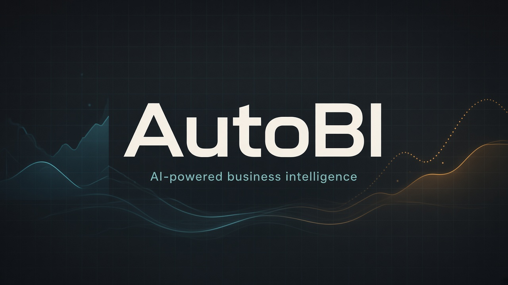
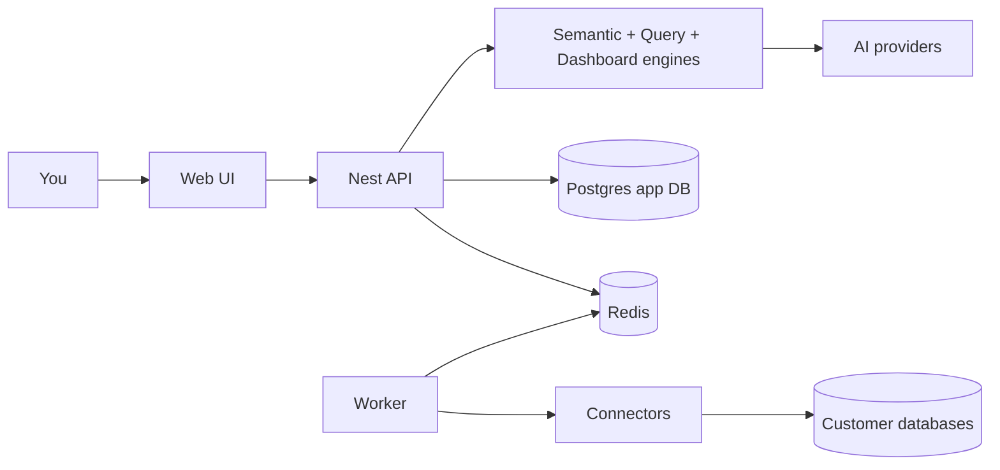

<p align="center">
  
</p>

<p align="center">
  
</p>

<h1 align="center">AutoBI</h1>

<p align="center">
  <strong>Ask questions in plain English. Get real dashboards from your databases.</strong>
</p>

<p align="center">
  Connect existing data · build a semantic layer · run safe analytical queries · generate interactive dashboards
</p>

<p align="center">
  
  
  
  
</p>

<p align="center">
  <a href="#-quick-start">Quick start</a> ·
  <a href="#-how-it-works">How it works</a> ·
  <a href="#-architecture">Architecture</a> ·
  <a href="#-tech-stack">Tech stack</a> ·
  <a href="#-documentation">Docs</a> ·
  <a href="https://github.com/MTaheridev/AutoBI">GitHub</a>
</p>

<p align="center">
  <sub>Created by <a href="https://github.com/MTaheridev">Mohammad Taheri (@MTaheridev)</a></sub>
</p>

---

## Why AutoBI?

Born out of real engineering frustration: waiting two sprints in a BI ticket queue for a 10-line `GROUP BY`, arguing over hoarded metric formulas, and watching budget burn on gatekeeping.  
AutoBI replaces politics with deterministic software: **AI proposes**, your team **approves**, and every query is **validated before it touches production data**.

| | |
| --- | --- |
| **Natural language → dashboards** | Describe what you need; get versioned, editable dashboard specs |
| **Bring your own databases** | Postgres, MySQL, SQL Server, SQLite — credentials never go to the AI |
| **Semantic layer with approval** | Entities, metrics, dimensions stay Proposed until a human accepts them |
| **Safe query engine** | Structured plans compile to dialect SQL with allow-lists and safety checks |
| **Provider-agnostic AI** | Configure the model you want; swap providers without rewriting the product |

---

## What’s included

- **Agent Mode** — chat workspace that connects databases, inspects schemas, builds queries, and ships live dashboards  
- **Data sources** — encrypted credentials, connection tests + read-only user probe, schema introspection  
- **Semantic engine** — AI/heuristic proposals + approve / reject workflow  
- **Query engine** — QueryPlans → dialect SQL + inferred joins → execute + run history  
- **Dashboard engine** — JSON specs, widget registry (ECharts), grid layout, versioned edits  
- **Security** — Argon2id, Redis httpOnly sessions, AES-256-GCM secrets, redacted agent logs  

---

## How it works



1. **Register** and create a workspace  
2. **Connect** a database and discover its schema  
3. **Review** proposed semantic definitions  
4. **Run** validated analytical queries  
5. **Generate** interactive dashboards from natural language  

---

## Architecture

<p align="center">
  
</p>

| Layer | What it does |
| --- | --- |
| `apps/web` | Next.js App Router UI |
| `apps/api` | NestJS REST API (`/api/v1`) |
| `apps/worker` | BullMQ jobs (schema introspection) |
| `packages/*` | Shared libs: connectors, AI, semantic / query / dashboard engines |

**Hard rules**

- Prisma talks only to AutoBI’s own Postgres — never to customer DBs  
- Connectors never import Nest or Prisma  
- AI never receives database credentials  

---

## Tech stack

<p align="center">
  
  
  
  
  
  
  
  
  
  
  
</p>

---

## Quick start

**Requirements:** Docker + Docker Compose (Node/pnpm only needed for local hot-reload)

```bash
cp .env.example .env
docker compose up --build
```

| Service | URL |
| --- | --- |
| Web | http://localhost:3100 |
| API health | http://localhost:3101/api/v1/health |
| Mailpit UI | http://localhost:8025 |

One compose file builds `api` / `worker` / `web` from [`infrastructure/docker/Dockerfile`](infrastructure/docker/Dockerfile). Postgres and Redis stay on the internal network; Mailpit supplies SMTP.

### Local pnpm (optional)

```bash
cp .env.example .env
pnpm install
pnpm -r build
docker compose --profile publish-data up -d postgres redis mailpit postgres-host redis-host
pnpm db:migrate:deploy
pnpm --filter @autobi/database generate
pnpm -r --filter './packages/*' build
pnpm dev
```

Useful commands:

```bash
pnpm lint
pnpm typecheck
pnpm test
pnpm db:seed
```

---

## Project layout

```text
AutoBI/
├── apps/
│   ├── web/          # Next.js UI
│   ├── api/          # NestJS API
│   └── worker/       # BullMQ worker
├── packages/
│   ├── database/     # Prisma schema + client
│   ├── connectors/   # Customer DB adapters
│   ├── ai/           # Provider-agnostic AI layer
│   ├── semantic-engine/
│   ├── query-engine/
│   ├── dashboard-engine/
│   ├── contracts/    # Zod schemas
│   ├── shared/       # Crypto, roles, errors
│   └── config/       # Env validation
├── infrastructure/docker/Dockerfile
└── docs/
```

---

## Documentation

| Doc | Topic |
| --- | --- |
| [Docs index](docs/README.md) | Start here |
| [Architecture](docs/ARCHITECTURE.md) | Services & package boundaries |
| [Connectors](docs/CONNECTORS.md) | External databases |
| [Semantic Engine](docs/SEMANTIC_ENGINE.md) | Propose / approve flow |
| [Query Engine](docs/QUERY_ENGINE.md) | Plans, SQL, safety |
| [Dashboard Engine](docs/DASHBOARD_ENGINE.md) | Specs & widgets |
| [AI Engine](docs/AI_ENGINE.md) | Provider layer |
| [Security](docs/SECURITY.md) | Auth, secrets, trust boundaries |
| [Database](docs/DATABASE.md) | Prisma / app DB |
| [Development](docs/DEVELOPMENT.md) | Local workflow |
| [PRD](docs/PRD.md) | Product requirements |
| [Deploy](docs/DEPLOY.md) | Compose & ops |

---

## Security posture

- Passwords: **Argon2id**  
- Sessions: **Redis** + httpOnly cookies  
- Data-source secrets: **AES-256-GCM**  
- Customer DB access: **connectors only** (never Prisma, never AI)  
- Dashboards: **structured JSON** — no AI-generated executable frontend code  

Details: [docs/SECURITY.md](docs/SECURITY.md)

---

<p align="center">
  <sub>Built as a modular TypeScript monorepo · AutoBI 1.0.0</sub><br/>
  <sub>Special thanks to Morteza, the one who made this idea come to my mind</sub>
</p>
